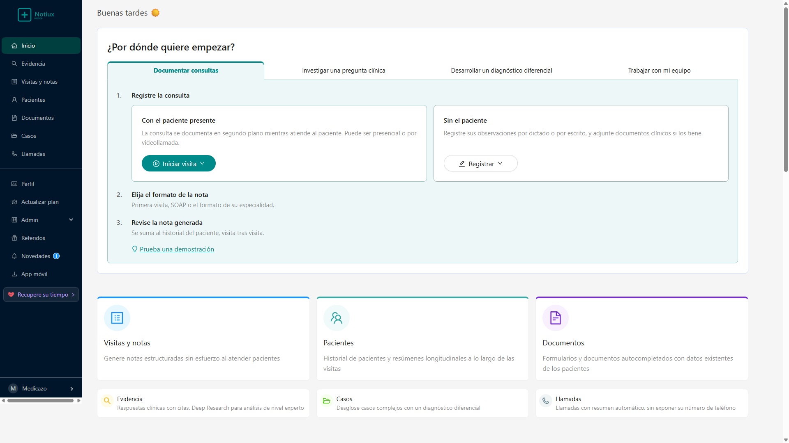

# Notiux Médica - Asistente local para Profesionales de la Salud

Interfaz local de demostración con servidor Node.js, datos de prueba en JSON y generación de texto mediante Gemini.

---

## 📸 Vista Previa de la Aplicación Local

Vista de la aplicación local:



---

## 🔬 Ingeniería Inversa y Arquitectura del Clon

Utilizando la metodología de **Reverse-Engineer-Anything**, se realizó el siguiente proceso de análisis y extracción:

1. **Mapeo de Chunks y Árbol de Dependencias de Frontend:**
   - La aplicación original utiliza **React 18** empaquetado con **Rolldown / Vite**, componentes de **Ant Design**, e internacionalización **i18next** (español, inglés y portugués).
   - Se recuperaron e inspeccionaron **287 módulos y assets** (código JavaScript, hojas de estilo CSS, fuentes e iconografía médica en SVG) directamente de los servidores de origen.

2. **Ingeniería Inversa de la API y Protocolo de Comunicación:**
   - Se analizó el cliente HTTP (`authRequest`) y los endpoints de la API de **Notiux Médica** (conectados directamente a la suite local).
   - Se identificó la superficie completa de endpoints REST:
     - `/account`: Autenticación, rol médico (`md`), organización, capacidades y estado FTUE.
     - `/note_types/recommended`: Plantillas de notas (SOAP, Primera visita, Seguimiento).
     - `/patients`: Expedientes clínicos, demografía, alergias y antecedentes.
     - `/sessions`: Registro de consultas presenciales/videollamada, dictado y generación de notas clínicas.
     - `/cases`: Asistente de razonamiento clínico y diagnóstico diferencial.
     - `/queries`: Borradores de respuesta clínica y modo Deep Research mediante IA.
     - `/billing/current_subscription`: Estado del plan y suscripción.

3. **Bypass de Autenticación y Semillado Automático de Sesión:**
   - Se implementó un parche dinámico para redirigir las peticiones del frontend a `window.__API_BASE__` (servidor local).
   - Se inyectó la sesión autenticada con el perfil del usuario **Medicazo**, recreando exactamente el estado visual y funcional del screenshot original.

4. **Backend Local Autónomo y Persistente (`server.js`):**
   - Servidor HTTP nativo en Node.js (cero dependencias externas requeridas para arrancar).
   - Manejador de enrutamiento SPA (Single Page Application).
   - Base de datos simulada y persistente en JSON (`mock_db.json`) para pacientes, consultas, casos clínicos y respuestas de evidencia.

## Alcance y seguridad

- El servidor escucha en `127.0.0.1` por defecto. Para usar otro host, configure `HOST` explícitamente.
- `mock_db.json` guarda los datos en texto sin cifrar. Use únicamente datos sintéticos en esta versión local.
- El inicio de sesión es una sesión simulada para desarrollo. La API local no sustituye autenticación, autorización, cifrado, auditoría ni controles exigidos para datos clínicos reales.
- Las respuestas de Gemini son borradores que deben revisar los profesionales. La aplicación no valida de forma independiente las fuentes bibliográficas y no presenta citas como verificadas.
- Antes de publicar en la web, conecte una base de datos segura, aplique autenticación y autorización por usuario, proteja secretos del servidor, configure HTTPS, límites de uso, copias de seguridad y monitoreo.

---

## 🚀 Cómo Ejecutar la Aplicación

### Método 1: Un solo clic en Windows
Haz doble clic sobre el archivo:
```bat
iniciar.bat
```
Esto iniciará el servidor y abrirá la dirección local disponible en el navegador. Si el puerto 3000 ya está ocupado, el servidor probará los siguientes puertos.

---

### Método 2: Desde la terminal
1. Abre una terminal en esta carpeta.
2. Ejecuta:
   ```bash
   npm start
   ```
   *(O directamente: `node server.js`)*
3. Abre en tu navegador la dirección que imprime el servidor (normalmente):
   ```
   http://localhost:3000/?source=pwa
   ```

---

## 🩺 Módulos disponibles

- 🏠 **Inicio**: Tablero interactivo con flujo guiado inicial (*"¿Por dónde quiere empezar?"*), saludo dinámico según la hora del día (*"Buenas tardes ☀️"*), y accesos directos a todas las herramientas.
- 📋 **Visitas y notas**: Documentación de consultas con paciente presente o sin paciente (dictado/escrito), generación automática en formato SOAP o Primera Visita.
- 🔍 **Evidencia médica**: Preguntas clínicas con borradores de IA y modo Deep Research. Las referencias requieren verificación profesional.
- 📁 **Casos clínicos**: Generador de diagnóstico diferencial estructurado con probabilidades (Alta, Moderada, Baja) y justificación fisiopatológica.
- 👤 **Pacientes**: Directorio de expedientes clínicos, datos demográficos, notas asociadas y gestión de historial.
- 📄 **Documentos**: Visualización y gestión de archivos clínicos y consentimientos.
- 🏢 **Admin & Perfil**: Configuración de la práctica médica y datos del profesional de la salud.

---

## 📁 Estructura del Proyecto

```
├── index.html            # Entry point SPA con inyección de sesión de Medicazo
├── server.js             # Servidor Node.js con API REST mockeada y persistente
├── package.json          # Configuración del paquete y scripts npm
├── iniciar.bat           # Lanzador rápido para Windows
├── clone_rendered.png    # Captura de la interfaz
├── itaca-assets/         # 287 módulos y assets del frontend de Notiux Médica (JS, CSS, SVGs, iconos y fuentes)
├── tools/                # Scripts de auditoría, extracción y validación de REA
└── README.md             # Documentación del proyecto
```
